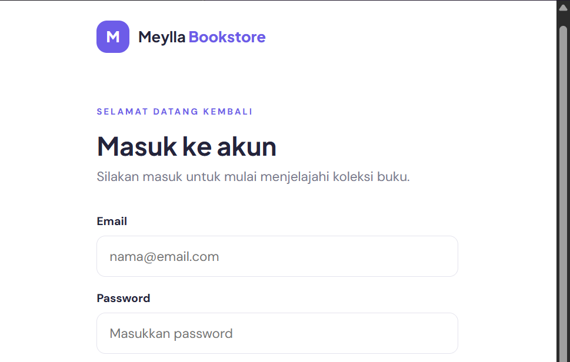
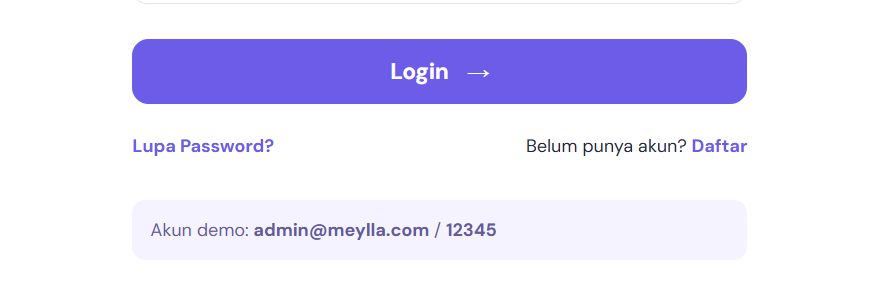
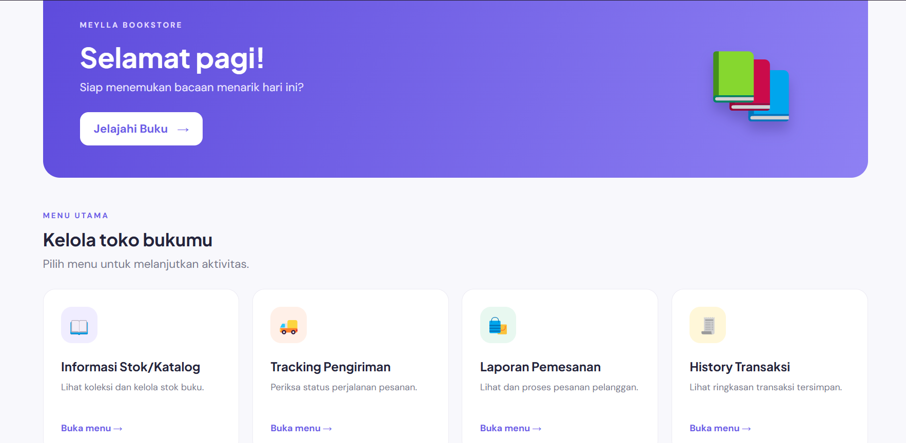
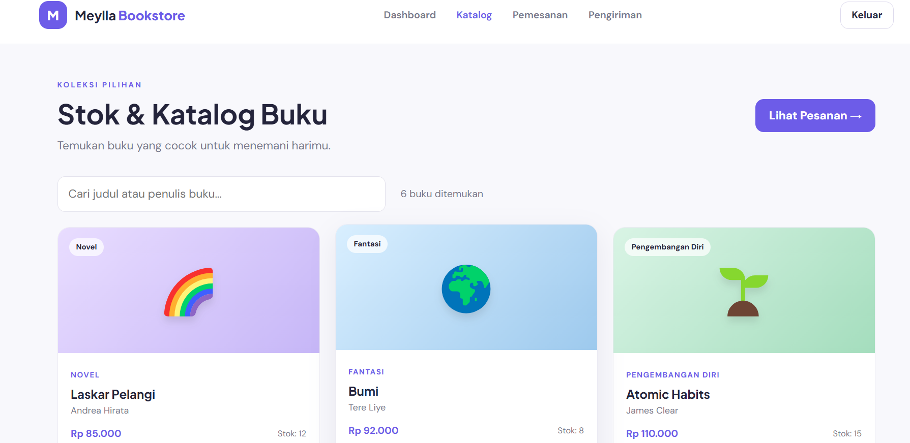
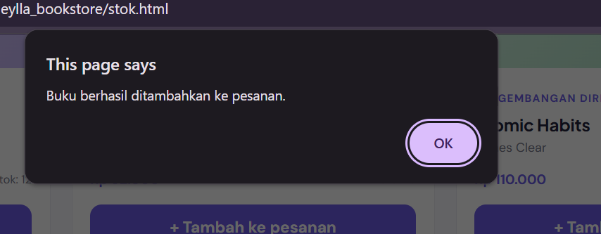
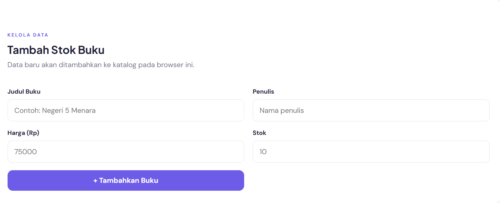
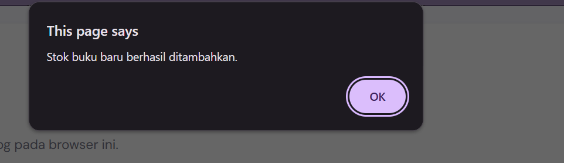
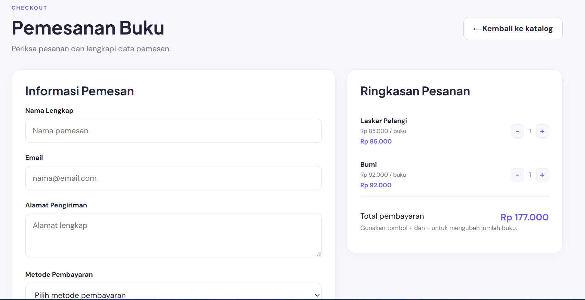
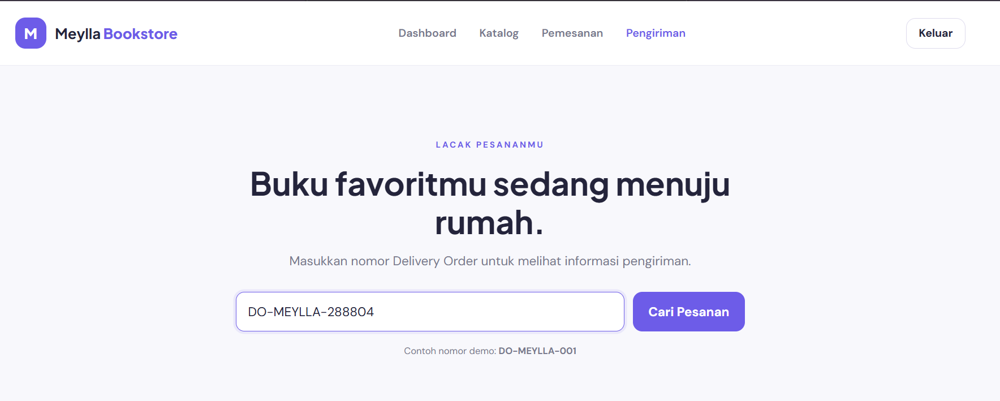
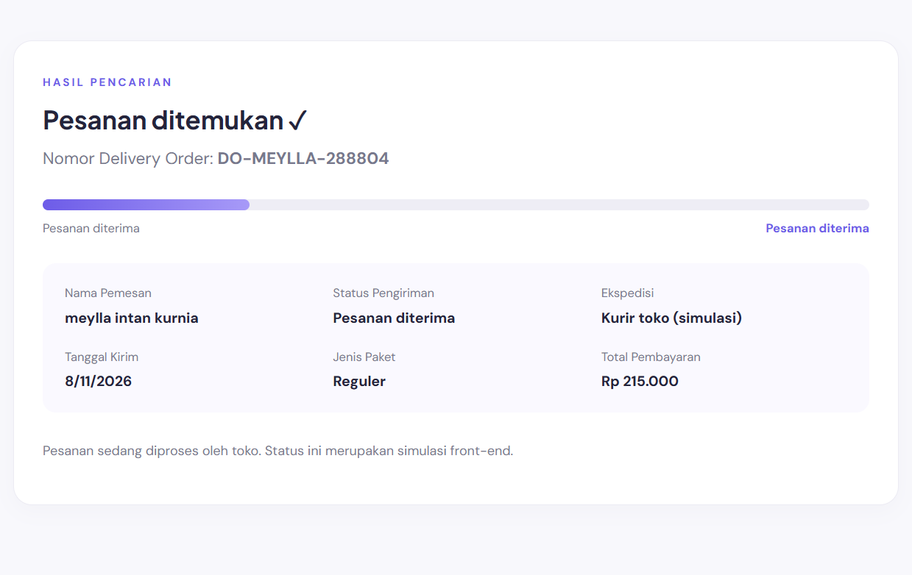

# Meylla Bookstore - UTS Pemrograman Web 1

## Cara menjalankan
1. Ekstrak folder `meylla_bookstore`.
2. Buka folder tersebut di Visual Studio Code.
3. Jalankan `login.html` menggunakan ekstensi Live Server (disarankan), atau buka langsung di browser.
4. Login dengan akun demo:
   - Email: `admin@meylla.com`
   - Password: `12345`
   

## Halaman
- `login.html`: login, lupa password, dan daftar (modal).
   
- `dashboard.html`: menu utama dan greeting sesuai waktu lokal.
   
- `stok.html`: katalog dinamis, pencarian, tambah stok, tambah ke pesanan.
   
   
   
   
- `checkout.html`: ubah jumlah pesanan, data pemesan/pembayaran, riwayat transaksi.
   
- `tracking.html`: pencarian nomor DO dan status pengiriman.
   
   

## Catatan
- Data katalog dan transaksi disimpan di `localStorage` browser agar simulasi tetap tersedia setelah halaman dimuat ulang.
- Login, pendaftaran, lupa password, pembayaran, dan pengiriman merupakan simulasi front-end, bukan autentikasi atau transaksi sungguhan.
- Nomor tracking contoh: `DO-MEYLLA-001`. Nomor DO baru akan muncul setelah membuat pesanan.
   